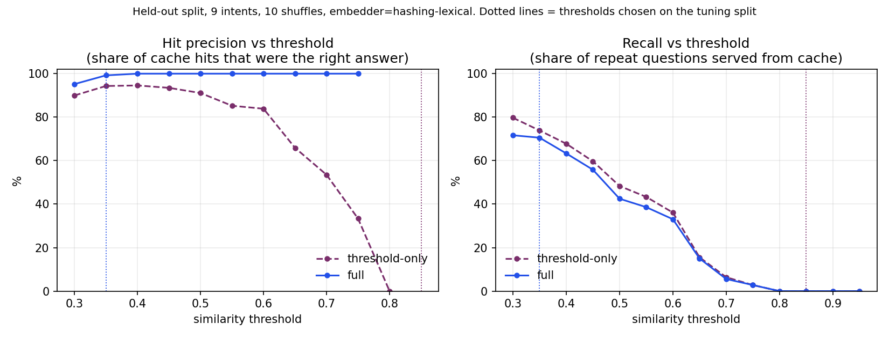
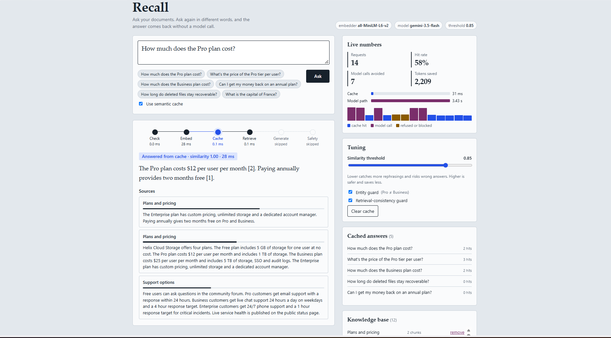
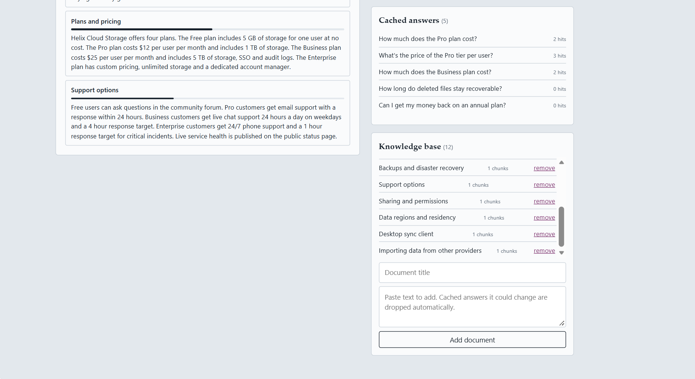

# Recall: A Semantic-Cache RAG Gateway

Ask questions over your documents. When someone asks the same thing in different words, **Recall answers from a semantic cache instead of calling the LLM**, reducing unnecessary model calls while preserving answer consistency.

The web interface shows exactly which pipeline steps ran and which were skipped.



## Application Screenshots

### Recall Dashboard and Semantic Cache Hit


### Knowledge Base — Document Management



## Why This Exists

A plain semantic cache ("cosine similarity ≥ threshold → return cached answer") has a nasty failure mode: **near-duplicate questions with different answers**.

For example:

- "How do Pro users contact support?"
- "How do Enterprise users contact support?"

These questions can have very similar embeddings, but their answers may differ. A naive cache can confidently return the wrong plan's answer.

Recall preserves cache efficiency while adding safeguards designed to reduce these errors.

| Safeguard | What it prevents |
|---|---|
| **Entity guard** | Serving a cached answer when questions differ on a plan name, number, or qualifier (Pro ≠ Enterprise, monthly ≠ annual) |
| **Retrieval-consistency guard** | Cache hits where the answer came from different documents than the new question retrieves |
| **Targeted invalidation** | Stale answers after a document is edited, added, or removed |
| **TTL + LRU** | Unbounded cache staleness and memory growth |
| **No-context refusal** | Hallucinated answers to out-of-scope questions; refusals are never cached |
| **Input/output guardrails** | Prompt injection attempts, PII/key leakage, and ungrounded answers |

## Results (Held-Out Benchmark, 10 Shuffles)

The benchmark uses 45 answerable questions from 9 intents that were never used to select the threshold, plus 12 out-of-scope questions and 5 injection prompts.

| Cache design | Served from cache | Correct when served | Wrong answers served / 45 |
|---|---:|---:|---:|
| No cache | 0% | n/a | 0 |
| Threshold-only, tuned safe (0.85) | 0% | n/a | 0 |
| Threshold-only @ 0.35 | 62.7% | 94.3% | 1.6 |
| **Recall (both guards) @ 0.35** | **56.9%** | **99.2%** | **0.2** |

- Out-of-scope questions refused: **100%**
- Injection prompts blocked: **100%**

Full methodology, caveats, and charts: [docs/REPORT.md](docs/REPORT.md).

*These figures are from the existing benchmark workload, not from the separate live Gemini integration test.*

## Quick Start

### Windows (PowerShell)

```powershell
git clone https://github.com/arya251223/recall.git
cd recall

python -m venv .venv
.\.venv\Scripts\Activate.ps1

pip install -r requirements.txt
python run.py
```

Open [http://127.0.0.1:8000](http://127.0.0.1:8000).

### Linux / macOS

```bash
git clone https://github.com/arya251223/recall.git
cd recall

python3 -m venv .venv
source .venv/bin/activate

pip install -r requirements.txt
python run.py
```

### Offline Mode

Recall runs without an API key using its offline components:

- A lexical embedding backend.
- An extractive LLM fallback that selects relevant sentences from retrieved context.

This allows the application to run without external LLM API calls.

### Optional: Live Gemini Integration

Recall also supports live Gemini responses through Google's `google-genai` SDK.

Install the SDK:

```bash
pip install google-genai
```

**Windows (PowerShell):**

```powershell
$env:GEMINI_API_KEY = "your-api-key"
$env:GEMINI_MODEL = "gemini-3.5-flash"

python run.py
```

**Linux / macOS:**

```bash
export GEMINI_API_KEY="your-api-key"
export GEMINI_MODEL="gemini-3.5-flash"

python run.py
```

The Gemini integration was successfully tested with **`gemini-3.5-flash`**.

The API key is read from the environment. You do not need to create a `.env` file or put your API key in the source code.

If no API key is provided, Recall uses its offline extractive fallback.

### Optional: Dense Semantic Embeddings

For better paraphrase recognition, install Sentence Transformers:

```bash
pip install sentence-transformers
```

Set the embedding backend:

**Windows (PowerShell):**

```powershell
$env:EMBEDDER = "minilm"
python run.py
```

**Linux / macOS:**

```bash
export EMBEDDER=minilm
python run.py
```

MiniLM provides dense semantic embeddings and can improve paraphrase recall compared with the bundled lexical embedder.

> **Model names:** `gemini-1.5-flash`, used in many older tutorials, was shut down on 2025-09-29. Recall defaults to the `gemini-flash-latest` alias and includes a fallback chain for unavailable models. The tested configuration used `gemini-3.5-flash`. For production, pin a supported model and check Google's model deprecation documentation.

## How a Question Flows

```text
Question
   |
   v
[1 Check]       Length and prompt-injection patterns
   |
   v
[2 Embed]       Generate embedding once
   |
   v
[3 Retrieve]    Retrieve top-k document chunks
   |
   v
[4 Cache]       Find nearest cached question
   |
   +-- Entity guard
   |      Pro vs Enterprise?
   |
   +-- Retrieval-consistency guard
   |      Same source documents?
   |
   +-- Accepted
   |      Return cached answer
   |      Skip generation and safety stages
   |
   v
[5 Generate]    Gemini or offline extractive fallback
   |
   v
[6 Safety]      Redact emails, phones, and keys;
   |             check grounding
   |
   v
Cache answer only if grounded and not an
"I don't know" response
```

The web UI visualizes the pipeline for every question: ink dots indicate executed stages, cobalt indicates a cache hit, and dashed grey indicates skipped stages.

## HTTP API

| Method & path | Purpose |
|---|---|
| `POST /api/query` | Ask a question. Accepts `{"question": "...", "use_cache": true}`. Returns answer, source, similarity, sources, pipeline trace, token estimates, and rejected near-matches. |
| `GET /api/stats` | Hit rate, calls avoided, tokens saved, latency, and recent requests |
| `GET/POST /api/documents` | Manage the knowledge base |
| `DELETE /api/documents/{id}` | Remove a document with automatic cache invalidation |
| `GET /api/cache` | Inspect cached answers |
| `POST /api/cache/clear` | Clear the cache |
| `POST /api/config` | Change `cache_threshold`, `entity_guard`, and `consistency_check` live |
| `GET /api/health` | Runtime configuration and health information |

Example request:

```bash
curl -s localhost:8000/api/query \
  -H 'Content-Type: application/json' \
  -d '{"question":"How much does the Pro plan cost?"}' \
  | python3 -m json.tool
```

## Configuration (Environment Variables)

| Variable | Purpose / default |
|---|---|
| `PORT` | Server port (`8000`) |
| `HOST` | Server host (`127.0.0.1`) |
| `GEMINI_API_KEY` | Optional Gemini API key |
| `GEMINI_MODEL` | Gemini model (`gemini-flash-latest` by default) |
| `EMBEDDER` | Embedding backend (`auto`, `hashing`, or `minilm`) |
| `CACHE_THRESHOLD` | Semantic similarity threshold |
| `CACHE_TTL_SECONDS` | Cache entry lifetime (`86400`) |
| `CACHE_MAX_ENTRIES` | Maximum cache entries (`1000`) |
| `TOP_K` | Number of retrieved chunks (`3`) |
| `RATE_LIMIT_PER_MIN` | Requests per minute (`60`) |
| `KB_DIR` | Knowledge base directory |

> **Thresholds are embedder-specific.** The `0.35` threshold is tuned for the bundled lexical embedder. The `0.85` default for MiniLM is a common starting point but has not been tuned or benchmarked in this project. Run `python -m bench.benchmark` with `EMBEDDER=minilm` to evaluate and select a suitable threshold.

## Tests and Benchmark

```bash
./tests/run_all.sh
```

Runs 38 unit/integration tests and the frontend smoke test (requires Node.js).

```bash
python -m bench.benchmark --seeds 10
```

Regenerates `docs/benchmark_results.json` and benchmark charts (requires matplotlib).

## Project Layout

```text
recall/
├── run.py
├── recall/
│   ├── embeddings.py       lexical and MiniLM embedders
│   ├── vectorstore.py      exact inner-product index
│   ├── chunker.py          sentence-aware chunking with overlap
│   ├── knowledge_base.py   documents, chunks, retrieval, versioning
│   ├── cache.py            semantic cache, guards, TTL/LRU, invalidation
│   ├── guardrails.py       injection, PII redaction, grounding, rate limiter
│   ├── llm.py              Gemini adapter and extractive fallback
│   ├── pipeline.py         orchestration and per-stage trace
│   ├── metrics.py          thread-safe dashboard counters
│   └── server.py           stdlib HTTP server and static UI
├── web/
│   ├── index.html
│   ├── style.css
│   └── app.js
├── data/
│   └── knowledge_base/     12 sample docs ("Helix Cloud Storage")
├── tests/                  unittest suite and Node frontend smoke test
├── bench/                  labelled workload, benchmark and plots
└── docs/                   report, benchmark results and charts
```

## Known Limitations

- **Lexical embedding limitations:** The bundled lexical embedder uses stemming, synonyms, and hashed n-grams. It can miss paraphrases that share few words, such as "How many API requests per minute?" versus "What is the API rate limit?". MiniLM is available for denser semantic recall.
- **Gemini testing:** The Gemini adapter has been successfully tested manually with `gemini-3.5-flash`. Automated tests use a stub client rather than making live API calls.
- **MiniLM testing:** The MiniLM backend is not exercised in CI.
- **Heuristic entity guard:** It uses capitalized words, numbers, and a small qualifier list. Lowercase-only distinctions can slip through.
- **In-memory storage:** The cache and uploaded documents are lost on restart. The application currently uses a single process.
- **Benchmark scope:** The benchmark is small and hand-written. Treat the results as a demonstration of the method, not a general performance guarantee.

## License

MIT. See [LICENSE](LICENSE).

## Author

**Aryan**

- GitHub: [@arya251223](https://github.com/arya251223)
- Portfolio: [aryan-2512.netlify.app](https://aryan-2512.netlify.app)
- Email: aryan.carrer@gmail.com
